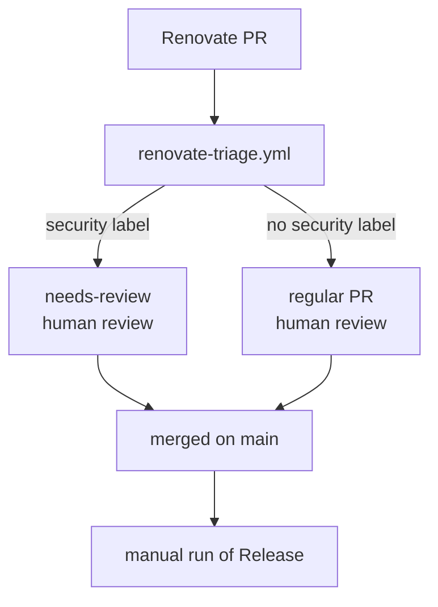

# Dependency updates (Renovate)

Dependencies are kept up to date by the hosted [Mend Renovate](https://developer.mend.io/github/algoan/nestoa)
app, configured in [`renovate.json`](../renovate.json). Security PRs are labelled with the shared
actions of [`algoan/renovate-security-actions`](https://github.com/algoan/renovate-security-actions),
the public counterpart of the flow `algoan/backend` runs from `algoan/private-actions`. The **hotfix
flow is off** and there is **no automerge**: see [Routing](#routing).

## What happens after a merge

A merge on `main` releases nothing. The binary and its npm packages are published when someone runs
the **Release** workflow (see [Release](development.md#release)): a security fix in a crate reaches
users with the next release, so run it once the fix is merged.

## What Renovate updates

| Manager          | Files                                                                                         |
| ---------------- | --------------------------------------------------------------------------------------------- |
| `cargo`          | `crates/nestoa/Cargo.toml` and `Cargo.lock` (the workspace `Cargo.toml` declares no crate)    |
| `npm`            | `npm/nestoa/package.json`: `engines.node` only (see below)                                    |
| `github-actions` | `.github/workflows/*.yml`: actions, and the `node-version` of every `actions/setup-node` step |

- The five `node-version: 26` of `ci.yml`, `benchmark.yml` and `release.yml` are one dependency
  (`node`): Renovate moves them together, in one PR.
- The `optionalDependencies` of `npm/nestoa/package.json` (`@algoan/nestoa-<platform>`) are nestoa's
  own platform packages, stamped with the released version by `npm/prepare-publish.js`: Renovate
  ignores them.
- Not tracked, on purpose: `dtolnay/rust-toolchain@stable` (the latest stable Rust), the
  `node:lts-alpine` image of the musl smoke test and the runner images of the release matrix
  (`ubuntu-22.04` is the oldest supported Ubuntu, for the glibc the binary links against).

Routine updates are grouped into one weekly PR (Monday before 6am, Europe/Paris); majors (e.g. the
`swc` crates) come on the same schedule, one PR per group. `Cargo.lock` is re-locked weekly, as it
decides what the released binary contains (`cargo build --locked`).

Security PRs (RustSec advisories through OSV, GitHub advisories) are opened immediately at the
**lowest fixing version**, without waiting for Monday. A fix inside the declared range
(`clap = "4"`) only moves `Cargo.lock`.

## Routing

- **`renovate-triage.yml`** (`pull_request_target`) runs on every Renovate PR, from the base commit:
  nothing from the PR runs with the write `GITHUB_TOKEN`, which matters on this public repository.
  The triage scores lockfiles of npm, pnpm, uv, poetry, Maven poms and Dockerfiles: none of them
  exists here, and **Rust crates are not scored**. A PR Renovate labels `security` gets
  `needs-review` and a comment; the others stay regular PRs. Once a scored ecosystem exists in the
  repository (`ecosystems: auto`), its fixes get a CVSS.
- **No automerge**: no PR can reach the automerge tier without a score. Every Renovate PR is merged
  by a human once **CI** (`Test & build`, `npm packaging`, `Lint (fmt + clippy)`, the npm install
  smoke tests) and **Benchmark** are green.

## Configuration

| Repository variable        | Default | Notes                                                |
| -------------------------- | ------- | ---------------------------------------------------- |
| `CVSS_AUTOMERGE_THRESHOLD` | `4.0`   | Unused while nothing is scored                       |
| `CVSS_HOTFIX_THRESHOLD`    | `9.0`   | Unused while the hotfix flow is off                  |

No secret used: the action is public, called with `uses:` and pinned by commit SHA with the tag in a
comment, which Renovate's `github-actions` manager keeps up to date. Repository settings: Renovate app
installed, Dependabot alerts on.
