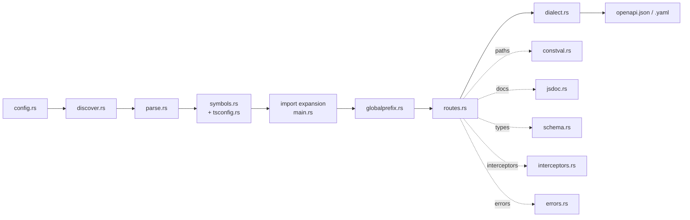

# Architecture

nestoa is a single Rust binary (`crates/nestoa`). It reads TypeScript source
with the [swc](https://swc.rs) parser and never compiles, imports or runs the
project. The same source therefore always gives the same document, which is
what makes it safe to run in CI.

The pipeline is a straight line, orchestrated by `main.rs`. Each stage is one
module:

1. **Load** the config, following `extends`.
2. **Discover** the source files under `include`.
3. **Parse** each file into an AST, with its comments indexed.
4. **Index** every exported declaration into a cross-file symbol table.
5. **Expand** the table with every module the discovered files import from
   outside `include`: relative files, tsconfig-aliased libraries and allowlisted
   packages. Routes still come only from the discovered files.
6. **Read the bootstrap** for the global prefix and versioning.
7. **Extract routes** from `@Controller` classes, lowering every type they
   reference to JSON Schema, and assemble the document.
8. **Downgrade** to OpenAPI 3.0.3 when asked, then write the file.

## Modules

### `main.rs`

CLI parsing (`clap`), orchestration, and the import expansion pass (`expand_packages`). That pass walks the import graph of the discovered files and parses every module reached through a relative import, a tsconfig alias, an `export * as` namespace target, or a package matching `resolvePackages`. For packages it parses the `.d.ts` entry point and the relative files it re-exports.

### `config.rs`

loads `nestoa.config.{json,yaml,yml}` from the project root (or `--config`). Defines every option documented in [options](options/README.md), with its defaults, and resolves `extends` by deep-merging JSON values before deserializing (unknown keys are rejected). A relative `output` in the config is resolved against the analysed project directory; the `--config` and `-o` flags are relative to the CWD.

### `discover.rs`

walks `include` paths (walkdir + globset) collecting `.ts`, `.tsx`, `.mts` and `.cts` files.

### `parse.rs`

swc-backed parser; `.d.ts`/`.d.mts`/`.d.cts` files are parsed in declaration mode. `ParsingContext` owns the shared `source_map`. Each `ParsedFile` carries a `DocComments` index (`jsdoc.rs`) built from swc's comments: every comment is keyed by the position of the first non-whitespace byte after it, so a node's JSDoc is the nearest `/** */` block in the run of comments directly before its span start (a plain or `//` comment in between is skipped, as in TypeScript). A top-level declaration's span leaves out its `export` keyword and class decorators, so the index also maps its start back to them. Each `ParsedFile` also keeps swc's `SourceFile`, whose text `schema.rs` slices for `x-unresolved` source excerpts.

### `symbols.rs`

`Project` builds a cross-file symbol table of every exported class/interface/type-alias/enum, resolving `import`, `export *`, `export * as Ns` (namespaces), barrel files, tsconfig path aliases, and node_modules package declarations so types can be looked up across modules. `resolve_namespace_member` handles namespace-qualified types like `Enums.Species`, where the namespace is a module (`import * as`, `export * as`) or a TypeScript `namespace` block, nested ones included; `resolve` accepts the dotted name too. Same-named interfaces in one file merge into one `Symbol::Interface`. A module's `export default …` / `export = …` is recorded as its `default` export, which default imports follow. A name looked up from an importer only sees what the module exports (a declaration file exports everything), so a local declaration never shadows an `export *` re-export. Every lookup goes through the project's `Resolver`, which memoises relative targets, tsconfig aliases, `node_modules` package directories and package entry points, since the same modules are imported from many files and each lookup otherwise stats candidates and re-reads a `package.json`.

### `tsconfig.rs`

reads `compilerOptions.paths` from the project's `tsconfig.json` (following `extends` — a path, a package such as `@tsconfig/node20`, or a TS 5 array, later entries overriding earlier ones — to the config that declares them; JSONC comments and trailing commas are tolerated) and resolves alias patterns (incl. a single `*` wildcard) to in-repo files under the inherited `baseUrl`, or the declaring config's directory without one. As in TypeScript, an exact pattern wins over a wildcard, the longest wildcard prefix wins among those, and only the winning pattern's targets are tried; `best_match` implements that rule and is shared with package.json `exports`/`typesVersions` resolution in `symbols.rs`. This is how workspace-package imports like `@acme/core` → `libs/core/src` resolve in an Nx/pnpm monorepo.

### `globalprefix.rs`

reads the bootstrap file (`main.ts` first, among the discovered files only, never a workspace lib) into a `Bootstrap`: the global prefix from `app.setGlobalPrefix(...)` (string literal, local string `const`, or `node-config-ts` member resolved against `config/default.json`) and the routes its `exclude` option leaves unprefixed (`'health'`, `{ path, method: RequestMethod.GET }`, a trailing `(.*)`/`*` wildcard), plus `app.enableVersioning(...)` when it is URI versioning (its `prefix`, default `v`, and `defaultVersion`). `routes.rs` gives each handler the versions of its `@Version(...)`, else its `@Controller({ version })`, else `defaultVersion`, each adding a `v<N>` segment after the global prefix (`VERSION_NEUTRAL` adds none). The prefix fills `basePath` when it is unset and `detectGlobalPrefix` is on; an explicit `basePath` always wins, and then `exclude` is ignored. `detectGlobalPrefix` only governs the prefix: versioning is always read.

### `routes.rs`

`Extractor` finds `@Controller` classes (`export default` ones included), walks their methods and those inherited up the `extends` chain (a redeclared method shadows the base one) for HTTP-verb decorators (`@Get`/`@Post`/…/`@All`/`@Sse`; with several stacked, the topmost wins, as in NestJS), `@HttpCode` and `@Redirect` (a status evaluated by `constval.rs`, or a member of an enum such as `HttpStatus`), and `@Header('Content-Type', …)`, which sets the response media type. Controller and route paths go through **`constval.rs`**, which statically evaluates string literals, templates, `+`, variables, object-constant properties (`ROUTES.LIST`) and string enum members (`Species.CAT`) across modules; a path it can't evaluate is a warning and its routes are left out. Each Express path is expanded into OpenAPI paths: an optional parameter (`:id?`, `{/:id}`) gives both variants and a constraint (`:id(\\d+)`) becomes the parameter's `pattern`. Parameters map to their OpenAPI location (`@Param`/`@Query`/`@Body`/`@Headers` + config aliases): an object `@Query()`/`@Param()` gives one parameter per property, `@Headers()` without a name and the `Accept`/`Content-Type`/`Authorization` headers are left out (`Authorization` marks the operation as secured instead), a name read twice is declared once, and pipes shape the parameter (`DefaultValuePipe` → optional with `default`, `ParseIntPipe`/`ParseFloatPipe`/`ParseBoolPipe`/`ParseUUIDPipe` → wire type). File-upload interceptors (`FileInterceptor('cover')`, …) turn the request body into `multipart/form-data`. `to_openapi()` assembles the final document: it drops the body of a `204`/`205`/`304`, makes each `operationId` (`<Controller>_<method>`) unique in sorted path order, and writes each operation's `security` with the configured scheme.

### `constval.rs`

Statically evaluates the expressions used as paths, versions and decorator arguments: string literals, templates, `+`, `const` variables (followed through aliases), object-constant properties (`ROUTES.LIST`) and string enum members (`Species.CAT`), across modules. `let`/`var` are never evaluated, since their value can change.

### `schema.rs`

lowers TypeScript types to JSON Schema. This is the largest module and where most type-handling lives: primitives, arrays, tuples, unions (`anyOf`/merged enums), intersections (`allOf`), utility types (`Promise`/`Observable`/`Awaited`/`Partial`/`Pick`/`Omit`/`Record`/`NonNullable`/`Set`/`Map`/etc.; a property-set edit on a type with an unresolved parent keeps that parent as an `x-unresolved` `allOf` branch), class properties (fields, constructor parameter properties, initialiser-inferred types, and the `@Exclude`/`@ApiHideProperty`/`@IsOptional`/`@ApiPropertyOptional`/`@ApiProperty({required})` decorators, and the class-validator constraints, `@MaxLength`, `@Min`, `@IsInt`, …), `Exclude`/`Extract` (on the lowered union members; `x-unresolved` when assignability cannot be decided from the schemas), `readonly T[]`, `keyof typeof Enum`, `X['k']`, qualified enum members, `Date`. Reusable named types are collected into `ComponentSchemas` and referenced via `$ref`.

### `jsdoc.rs`

parses leading JSDoc into `summary`/`description`, `@param` descriptions, `@deprecated`, `@internal`/`@private`, and `@route-mapping`. The last lets one method serving several paths (`@Get([':id/books', ':id/reviews', …])`) declare a distinct response type per path via a brace-body of `'<path-suffix>': <TypeName>` pairs; `routes.rs` matches each concrete path against the trailing suffix and resolves the named type to a schema, overriding the (necessarily unified) declared return type. This is the source-annotation counterpart to the config-driven per-path `response` override in `interceptors.rs`.

### `interceptors.rs`

applies NestJS interceptor transforms to a route's request/response (called from `routes.rs`). For `@UseInterceptors(...)` it resolves each interceptor class and reads its `implements NestInterceptor<In, Out>` type arguments: the handler's (Promise/Observable-unwrapped) return type is unified against `In` (`unknown`/`any` match anything; a handler without a return type only takes an interceptor whose `Out` mentions none of its generic params) to bind the interceptor's generic params (a minimal `unify` + `TypeEnv` of `name -> (origin_file, TsType)`), then `Out` is lowered as the response schema with those bindings active. With several interceptors, each one's `In` is matched against the previous one's `Out`, so its bindings are read under that interceptor's bindings alone (a chained `Box<B>` may bind `B` to its `A`) and replace them. Lowering `Out` performs **generic instantiation**: a named reference carrying type arguments (`BatchResponse<Omit<T, 'createdAt' | 'updatedAt'>>`) binds the referenced declaration's *own* generic parameters to the (eagerly-lowered) arguments and inlines its body per route — so a nested generic element type resolves to the concrete element and utility types like `Omit` applied to a bound param work. Outside interceptors (`SchemaCtx::inline_generics` unset), the same instantiation registers one component per distinct binding instead of inlining, named after the declaration and the arguments written (`Page<Book>` → `PageBook`, `Box<string[]>` → `BoxStringArray`, a bare `Tagged<T = string>` → `Tagged`); type parameters left without an argument take their default, lowered in the declaration's scope under the parameters bound before it. A bare reference to a generic declaration that binds nothing (no arguments, no defaults) stays one shared component with `x-unresolved` parameters. Interceptor output reuses only the recursive ones among these components, so the rest stay inlined whatever was lowered first, and a component is always lowered without the bindings in scope where it is first reached. The optionality check binds a generic alias's own parameters the same way (`type Id<T> = T`). A generic type whose body reaches itself has no finite inlining, so `SchemaCtx::instantiating` carries the instantiations currently being lowered, outermost first, each identified by its declaration *and* the lowered arguments bound to it. Arguments are lowered in the caller's scope *before* an entry is pushed, so a finite nesting (`Box<Box<T>>`) completes and pops before the outer level pushes and is never mistaken for recursion. Reaching an instantiation already in flight — same declaration, same arguments — is genuine recursion: the reference becomes a `$ref` to a name allocated at that point, built from the instance's own arguments (`TreeNode` + `Project` → `TreeNodeProject`), under which the finished body is registered. The *same declaration with different arguments* is not recursion (`Pair<A>` holding `other: Pair<string>`) and is lowered on its own so it keeps its own binding; only a polymorphically recursive type (`Nest<T>` holding `Nest<Nest<T>>`) produces a fresh binding at every level and would never stop, so past `MAX_INSTANTIATION_DEPTH` levels of one declaration the expansion folds back onto the outermost instance in flight. `ComponentSchemas::instantiated` records each finished instantiation against that same key: it keeps `TreeNode<Project>` and `TreeNode<Widget>` apart, and — since a `SchemaCtx` is built per interceptor rewrite — lets a later route binding the same arguments reuse the component instead of lowering a near-duplicate. A declaration nothing refers back to is still inlined whole and never named. Typical cases are a pagination interceptor `PaginateInterceptor<T>` (`Page<T>` → `PaginatedData<T>`) and a batch interceptor `BatchInterceptor<T>` (`T[]` → `BatchResponse<Omit<T, …>>`). Request-body reshaping (e.g. single-or-array) is *not* in the type signature, so it comes from config instead.

### `errors.rs`

Reconstructs the `400`/`401`/`403`/`404`/`409`/`413`/`422` responses NestJS produces but that never appear in a handler's return type. `routes.rs::extract_class` gathers the AST signals (guards, opt-out and role decorators, a `@Body`, pipes, `throw new <HttpException>(…)` in the handler body, `@throws` tags, the method and full path) into `errors::RouteSignals`; `errors::compute` is the pure mapping from those signals and the [`errorResponses`](options/error-responses.md) config to a `status -> description` map, ordered and deduped by status, with the most specific source inserted first. Every error response `$ref`s one shared `Error` component (`error_schema`, or the `errorResponses.schema` object), renamed by `error_schema_name` when a project schema already has the name; a type `errorResponses.schema` names is lowered instead by `Extractor::error_body` at the end of `extract_all`, and referenced in its place. The same auth signals decide each operation's `security` requirement in `routes.rs`.

### `dialect.rs`

when `openapiVersion` is `3.0.3`, rewrites the finished document's 3.1-only constructs in one pass (called at the end of `routes::to_openapi`, so it also covers schemas supplied verbatim via `interceptors[].response.schema`): `type: [T, "null"]` → `type: T` + `nullable: true`, a `null` `enum` member → `nullable: true`, a `{"type": "null"}` union branch dropped (unwrapping a union that only existed to carry it, and rewriting the member it folds up), a standalone `type: "null"` degraded to an unconstrained schema, a genuine multi-type array split into an `anyOf` of one-type branches, `const` rewritten as a single-value `enum`, a numeric `exclusiveMinimum`/`exclusiveMaximum` turned into the bound plus a boolean flag, a schema's `examples` array reduced to its first `example`, and a tuple (`prefixItems`) merged into a homogeneous `items` — capped by `maxItems` when closed (`items: false`), uncapped when it has a tail — with `minItems` never synthesized since `prefixItems` does not require its positions. The nullable-union, standalone-null and tuple conversions lose information, unavoidably — `nullable` is meaningless without a sibling `type`, so 3.0.3 can express neither a nullable `$ref` nor a null-only schema, and its arrays have no per-position types. The walk is over the raw document rather than the OpenAPI object model (so it holds wherever a schema appears), and skips instance-valued keywords — `example`, `examples`, `default`, `enum`/`const` contents, `x-` extensions — so a documented payload shaped like a schema is never rewritten — in keyword position only, since inside `properties` (and the other name-keyed maps) the same word is a field name whose schema must still be walked. Default is `3.1.0`, where the pass never runs.

### `diag.rs`

Records every warning (`diag::warn`). `--strict` reads them at the end; tests read them with `diag::take_warnings`.

## Cross-cutting design

- **Unresolvable types** (typically from `node_modules`) are emitted as `x-unresolved: <TypeName>` rather than silently becoming `{}`, so gaps are visible. Type forms nestoa does not lower (mapped, conditional, `typeof`, other `keyof`, …) are marked the same way, with their source text.
- **Diagnostics.** Every warning goes through `diag::warn`, which records it; `--strict` writes the output, lists each `x-unresolved` by JSON pointer, then exits 1 if there was any warning or unresolved type. Tests read the recorded warnings with `diag::take_warnings`.
- **Output dialect.** The analyser always lowers into JSON Schema 2020-12 (3.1). Most of that output reads identically under 3.0, and `schema.rs` keeps it that way: `ref_to_allof` (called from `attach_doc_to_map`, and only when a sibling is actually being added) rewrites `{$ref}` to `allOf: [{$ref}]` before hanging `description`/`deprecated`/`example` off it, since 3.0's JSON Reference semantics ignore every sibling of a `$ref`; and union members with no wire representation (`void`/`undefined`/`never`, which `keyword_schema` lowers to a JSON `null`) are filtered out of unions rather than emitted as a `null` branch — a `T | undefined` property is already expressed by its absence from `required`. **Nullability and tuples are the two constructs that cannot be spelled the same way in both versions**, so a 3.1 document is never also a valid 3.0 one: `make_nullable` encodes `| null` the 2020-12 way (widen a string/array `type`, add `null` to an `enum`'s values, append a `{"type": "null"}` branch to an `anyOf` (or a verbatim `oneOf`), or wrap a `$ref`/`allOf`/`x-unresolved` in `anyOf: [<schema>, {"type": "null"}]`; an empty `any`/`unknown` schema is left alone), and a tuple lowers to `prefixItems` + `items: false` (or `items: <rest>` for `[A, ...B[]]`). 3.0 has neither a `"null"` type nor tuples — see `dialect.rs` below for the downgrade and what it costs.
- **Determinism.** Nothing depends on the environment beyond the files read: discovered files are processed in sorted order, maps that reach the output are ordered, and no code is executed. Running nestoa twice on the same tree gives byte-identical output.
- **No runtime plugins.** Customisation is config ([`decoratorAliases`](options/decorator-aliases.md), [`interceptors`](options/interceptors.md), [`errorResponses`](options/error-responses.md), [`passthroughTypes`](options/passthrough-types.md)) or a one-file source change (see [Development](development.md#where-to-make-a-change)).

## npm distribution

`nestoa` (the published package, `@algoan/nestoa` on GitHub Packages) ships only a JS shim, `bin/nestoa.js`, as its `bin`. `install.js` (postinstall) detects platform, architecture and libc and resolves the matching `@algoan/nestoa-<tag>` optional dependency. When npm runs it outside Windows, it then replaces `bin/nestoa.js` with that binary (hard link, or copy across file systems), so `node_modules/.bin/nestoa` runs the binary with no Node process in between: about 30 ms and 40 MB less per run. The swap goes through a temporary file that must answer `--version` first and is renamed over the shim, so a binary that does not run leaves the shim in place, and a shim hard-linked into a package manager's store is never written through.

The shim stays wherever the `.bin` launcher runs the file with `node`: npm on Windows, pnpm and Yarn. It also stays when `NESTOA_BINARY` is set at install time, and when install scripts did not run (`--ignore-scripts`, or a package manager that requires approving them). The shim execs the binary, preferring `NESTOA_BINARY`, then the copy `install.js` put in `bin/`, then the optional dependency's own binary. Once the shim is replaced, `NESTOA_BINARY` has no effect on `.bin/nestoa`. See [Development](development.md#release) for publishing.
